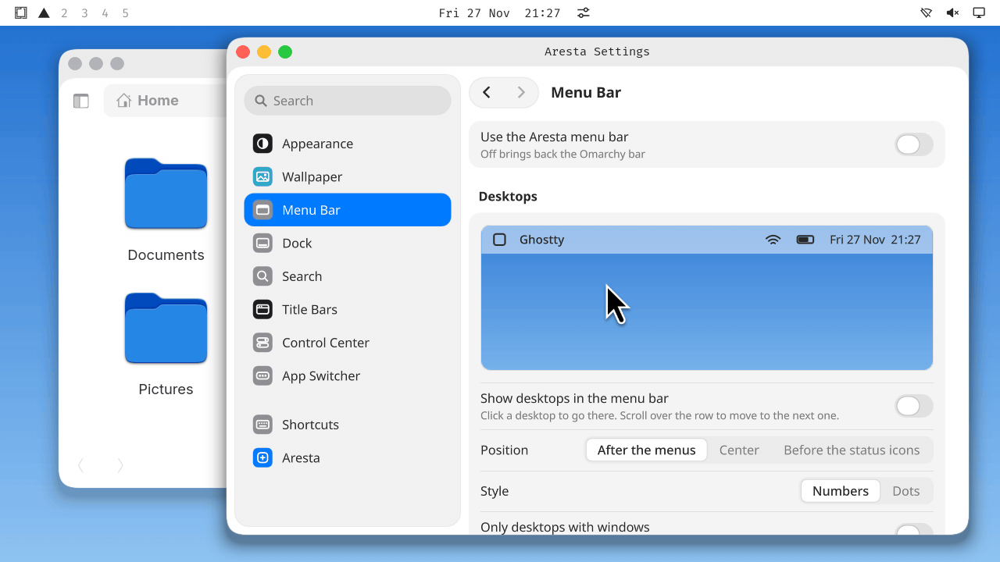
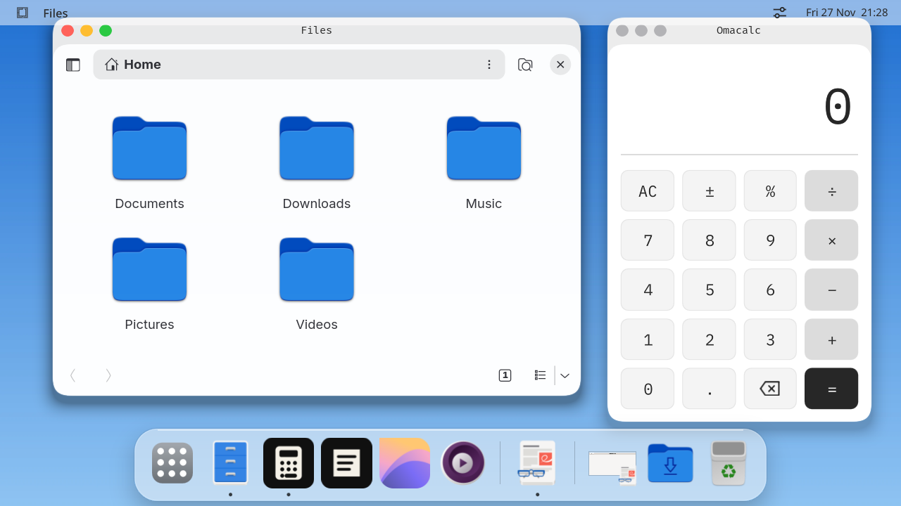
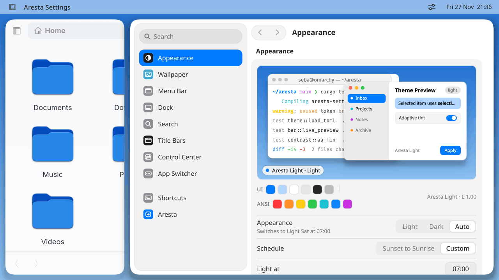
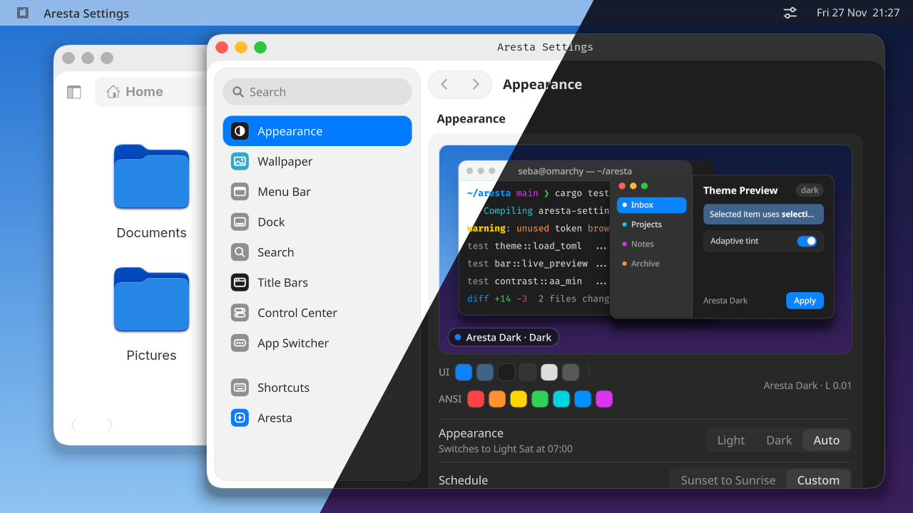
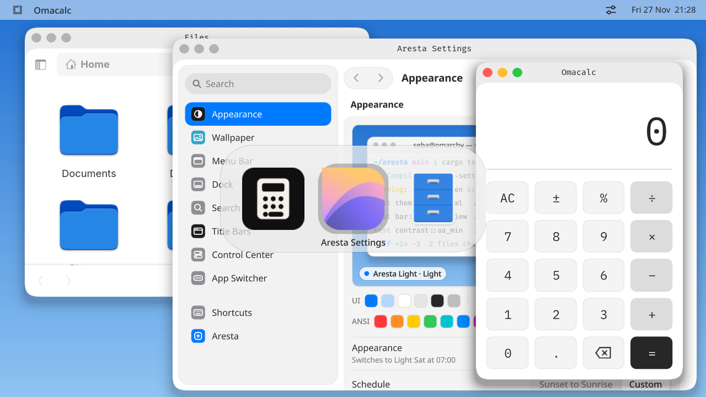
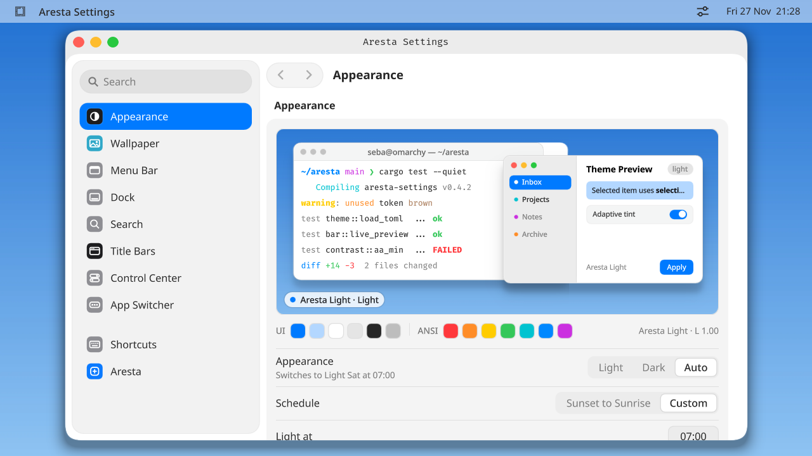

<h1 align="center">
  <picture>
    <source media="(prefers-color-scheme: dark)" srcset="assets/brand/lockup-dark.svg">
    <source media="(prefers-color-scheme: light)" srcset="assets/brand/lockup-light.svg">
    
  </picture>
</h1>

<p align="center">A crafted desktop, with rounded edges.</p>

Aresta is a desktop look for [Omarchy](https://omarchy.org) 4.5 or newer,
inspired by macOS.

| Part | What you get |
| --- | --- |
| [Menu bar](#menu-bar) | A slim top bar in place of the Omarchy bar |
| [Dock](#dock) | A dock with pinned apps, recent apps and minimized windows |
| [Control Center](#control-center) | Floating controls for Wi-Fi, Bluetooth, Focus, theme, Night Light, display, sound and media |
| [Search](#search) | The Omarchy menu as one search field |
| [Title bars](#title-bars-and-windows) | Traffic lights on floating workspaces, rounded corners everywhere |
| [Themes](#themes) | Works with every Omarchy theme, plus Aresta Light and Aresta Dark |
| [Shortcuts](#keyboard-shortcuts) | Super+Tab, Super+Q and other app keys on Super |
| [Aresta Settings](#aresta-settings) | One app that turns each part on or off |

Each part has a switch. Turning one off gives back Omarchy's own behavior.
See [Install](#install) to get started.

## Menu bar



The menu bar replaces the Omarchy bar.

- **Left:** the Omarchy menu button and the focused app's name.
- **Right:** your status widgets, third-party ones too, and the date and time.
- **Look:** text and icons in your theme's bar text color, dark on light themes
  and light on dark themes, on a translucent, unblurred background. It uses SF
  Pro when it is installed, else Inter or Noto Sans.

## Dock



The dock replaces the Omarchy dock at the bottom of the screen. It is a
frosted glass panel, light or dark with your theme.

- **Pinned apps** come first, in the order you set. Drag an icon to move it.
  Right-click an app to keep it in the dock or to remove it. A click starts
  the app or focuses its window, and a dot shows under an app that is open.
- **Recent apps** come next: open apps that are not pinned, then the last 3
  apps that are not pinned. The dock remembers them when the shell restarts.
- **Minimized windows** each get their own item, with a picture of the window
  and its app icon. A click puts that window back on the workspace it came
  from.
- **Downloads and Trash** stay at the right end. The first icon opens a grid
  of every app, which `omarchy-shell omarchy.dock apps` opens too.
- **Autohide** tucks the dock under the screen edge and frees its space. Move
  the pointer to the bottom edge to show it.

The dock uses the pins of the Omarchy dock, so your pins stay when you switch
between the two.

## Control Center


The Control Center button sits next to the clock. It opens a group of
floating pills in the top-right corner. The pills:

- turn Wi-Fi, Bluetooth and Focus on or off;
- switch between the light and the dark theme, and turn the night light on
  or off;
- set the display brightness and the volume;
- control the media that plays.

A chevron shows when you point at a pill. It opens Omarchy's own panel, such
as the Wi-Fi or the sound panel, in the same corner.

While it is on, the bar hides Omarchy's network, Bluetooth, sound, system
monitor and battery icons, unless you keep one in the bar.

## Search


Super+Space, the bar's menu button and `omarchy-menu` open one search field
with a blinking cursor. Results show apps first, then menu rows with their
path.

- **Math:** an expression such as `2^10` or `sqrt(2)*pi` shows its result in
  the field and on a card above the results. Enter or the copy button copies
  it.
- **Submenus:** a submenu shows as a chip in the field. Backspace on an empty
  field goes back.
- **Sections:** Ctrl+1 to Ctrl+9 open Apps, as an icon grid, or a menu
  section, because Super+1 to Super+9 switch workspaces. An optional row of
  filter buttons under the field does the same. Each button shows its name
  and shortcut on hover.
- **Size and place:** the card grows with the results up to the screen edge,
  then scrolls. Drag the card by its field or its sides to move it, or by its
  top or bottom edge to change its height. It opens that way next time on
  that display.
- **Scripts:** scripts that use the menu as a picker, such as
  `omarchy-menu-keybindings`, keep working.

## Title bars and windows



- **Windows on floating workspaces** get a title bar with traffic lights:
  close, minimize and maximize on the left, grey when the window is
  unfocused, icons on hover, and the title centered.
- **Tiled windows** get no title bar.
- **Every window** gets rounded corners, a soft shadow and a thin neutral
  outline instead of a colored border.

Turn a workspace floating with Omarchy's workspace layout toggle to see the
title bars.

## Themes



Every installed Omarchy theme is supported. The menu bar, Control Center,
Aresta Search, title bars, app switcher and Aresta Settings follow your active
theme's colors. The dock is light or dark with the theme. In Aresta Settings
under Appearance, pick any installed
Omarchy theme as your light theme or dark theme, and switch manually or on Auto
(sunrise/sunset or a custom schedule).

Two themes are included: **Aresta Light** and **Aresta Dark**, each with Yaru
blue icons and five original wallpapers in the colors of the Aresta logo: a
soft aurora, a horizon with the sun or the moon, a ribbon of light, a tile
floor and chamfered corners. The aurora is the default. Each wallpaper has a
light and a dark version, and a theme switch keeps the same one. Pick the
themes in Aresta Settings, the Omarchy theme menu or with
`omarchy-theme-set "Aresta Light"`.

## Keyboard shortcuts



| Shortcut | Action |
| --- | --- |
| Super+Tab | App switcher, like Cmd+Tab |
| Super+Q | Quit the app: close every window of its class, on all workspaces |
| Super+W | Close only the window (unchanged) |
| Super+M | Minimize the window to the dock (Omarchy's binding, unchanged) |
| `` Super+` `` | Cycle between windows of the same app, skipping minimized ones |
| `` Super+Alt+` `` | Quake console, moved from `` Super+` `` |

The app switcher shows one icon per app in most-recently-used order, in a
rounded strip in the middle of the screen. Hold Super, press Tab or Shift+Tab
or point at an icon to move, and release Super to switch. Click an icon to
switch at once, or press Esc to cancel. Switching to a minimized app brings
its window back.

The switcher replaces Omarchy's next and previous workspace bindings on
Super+Tab and Super+Shift+Tab. It is its own shell plugin, so it keeps
working when you switch back to the Omarchy bar.

## Aresta Settings



Aresta Settings is a small app with one section for each part. Open it from
the app launcher.

| Section | What you set |
| --- | --- |
| Appearance | Light, Dark or Auto; the light and the dark theme from the installed Omarchy themes, in lists that follow the themes you add or remove while the window is open; window shadows; translucent panel backgrounds and opacity for Control Center, Aresta Search and the app switcher; the Control Center and the status panels in the top-right corner. It also shows the colors of the current theme. Auto picks the light theme at sunrise and the dark theme at sunset, or at the two times you set under Schedule, Custom. |
| Wallpaper | The current wallpaper and a switch that keeps it when the theme changes. It lists the pictures of the theme, of `~/.config/omarchy/backgrounds/<theme>` and of folders you add. Add Photo copies a picture into `~/.config/omarchy/backgrounds/<theme>`. |
| Menu Bar | The menu bar itself; desktops in the bar (after the menus, in the center or before the status icons, as numbers or dots); the bar background opacity; the clock format. |
| Dock | The dock itself, with a preview (off gives back the Omarchy dock); icon size; magnification under the pointer; autohide; the dots under open apps; recent apps. |
| Search | Aresta Search itself (off gives back the Omarchy menu); size from 80% to 150%; a gray or theme accent selected row; the filter buttons; open with only the search field until you type; keyboard hints at the bottom of the card; lock the card's place and size; put it back at its default place and height. |
| Title Bars | The title bars themselves, with a preview of two windows on your wallpaper; title bars on tiled windows too; button position (left or right); grey traffic lights on unfocused windows; icons in the traffic lights on hover; title alignment; traffic light size. Off gives back Omarchy's own title bars. |
| Control Center | The Control Center itself (off gives back Omarchy's bar icons); the controls the panel shows; the Omarchy icons that also stay in the menu bar. |
| App Switcher | The Aresta App Switcher itself, with a preview of the strip on your wallpaper (off gives back Omarchy's Super+Tab and Super+Shift+Tab, which go to the next and previous workspace); new shortcuts for Switch apps and Switch apps backwards. |
| Shortcuts | Quit app, Cycle windows and the Quake console keys on or off, and new shortcuts for them. Omarchy's own bindings show as read-only. |
| Aresta | Rounded corners and their radius and shape, the thin border, the shadow and the bar size. |

Turning a part off gives back Omarchy's own behavior: the Omarchy bar, its
dock, status icons, title bars, square corners, colored border, menu, or its
Super+Q, `` Super+` ``, `` Super+Shift+` ``, Super+Tab and Super+Shift+Tab
bindings.

Changes apply at once. The app saves them to
`~/.config/aresta/settings.toml`, which the Hyprland config, the
bar and the dock read. Without that file, every option keeps its default.

The app is written in Rust with [cxx-qt](https://github.com/KDAB/cxx-qt) and
QML. To build it by hand you need Rust (`cargo`) and Qt 6:

```sh
cargo build --release --manifest-path app/Cargo.toml
```

## Install

```sh
git clone https://github.com/momoi-labs/omarchy-aresta
cd omarchy-aresta
./install.sh
```

It links `hypr/aresta.lua` into `~/.config/hypr`, adds
`require("hypr.aresta")` to `~/.config/hypr/hyprland.lua` before
`require("default.hypr.toggles")`, and reloads Hyprland. Before it edits
`hyprland.lua`, it copies the file to `$ARESTA_BACKUP_DIR/hyprland.lua.orig`
(default `/tmp/aresta`). It also links the repository into
`~/.config/omarchy/plugins` and selects the Aresta bar, after it copies
`~/.config/omarchy/shell.json` to `$ARESTA_BACKUP_DIR/shell.json.orig`.
It links `switcher/` into `~/.config/omarchy/plugins` and enables it. It
links `menu/` into `~/.config/omarchy/plugins` and enables it, which turns off
the Omarchy menu. It links `control-center/` into
`~/.config/omarchy/plugins` and enables it. It links `dock/` into
`~/.config/omarchy/plugins` and enables it, which turns off the Omarchy dock.
When Rafael Bertholdo's macOS Dock plugin is enabled, it disables that plugin,
because the Aresta Dock replaces it.
It links `themes/aresta-light` and `themes/aresta-dark` into
`~/.config/omarchy/themes`, and links a `theme-set` hook into
`~/.config/omarchy/hooks/theme-set.d` that keeps the current wallpaper on a
theme switch unless you turn that off. Finally, it builds Aresta Settings
with `cargo` and installs it to `~/.local/bin/aresta-settings`, with a
launcher entry in `~/.local/share/applications` and its icon in
`~/.local/share/icons/hicolor/scalable/apps`.
It also installs the `aresta-auto` systemd user timer, which runs
`aresta-settings --auto` every minute for Auto appearance. Auto reads your
location from `~/.local/state/omarchy/settings/weather.json`, else from
`https://geo.omarchy.org/`, and computes sunrise and sunset on your computer.
With a Custom schedule, Auto uses your local time and needs no location.
Running the script again changes nothing.

## Uninstall

```sh
./uninstall.sh
```

It restores `shell.json` from the backup (or selects the default bar when
the file changed since), disables Aresta Search so the Omarchy menu
comes back, disables the dock so the Omarchy dock comes back, disables the
Control Center, removes the plugin links, the theme links, the hook
link, the `require` line, the Hyprland link, the Aresta Settings binary,
launcher entry and icon and the `aresta-auto` timer, then reloads Hyprland. It
keeps your settings file.

## Credits

The title bar code and the dock are based on the
[macOS Dock plugin](https://github.com/rafabertholdo/omarchy-macos) by Rafael Bertholdo
(MIT), which builds on Omarchy's own dock. The app switcher is based on Renan Tonheiro's Switch Magic plugin
(MIT). See `LICENSE`.

The wordmark uses [Urbanist](https://fonts.google.com/specimen/Urbanist) (SIL
Open Font License 1.1).

macOS is a trademark of Apple Inc. Aresta is not affiliated with Apple.
